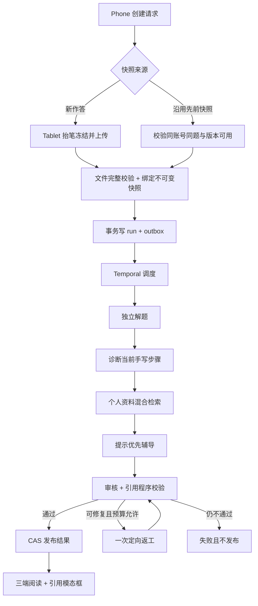

# 多 Agent 辅导、个人学习资料 RAG 与引用模态框

> 本文保存已审核的P0设计基线；当前P0–P6实现、标签和未过门槛见[里程碑](milestones.md)及[最新审核入口](../../testing/multi-agent-delivery/review-guide.md)。

- 状态：**P0 已于 2026-10-25 获用户审核通过，已授权提交、合并 develop，并按里程碑继续实施；本提交保存 P0 设计与验证基线。**
- 基线：`develop@0c8bd94556d417a00bde847b055d26363a46eda5`，核对日期 2026-10-25。
- 范围：BetterLearning 内当前题目与手写作答的解题、错误诊断、分步辅导，以及可追溯的个人历史引用。
- 本次产物：设计、OpenAPI、独立验证程序和实测报告；不改生产代码、依赖、迁移、部署配置。

## 1. 阅读顺序与结论

1. 本文：产品范围、角色和端到端设计。
2. [契约](contracts.md) 与 [OpenAPI](openapi.yaml)：字段、状态、接口和竞争语义。
3. [技术选型](decisions.md)：Temporal、LangGraph、pgvector 和模型策略。
4. [评测方案](evaluation.md)：真实效果和故障验收门槛。
5. [实施里程碑](milestones.md)：P0–P6 的依赖、职责和审核门禁。
6. [P0 验证报告](../../testing/multi-agent-p0/README.md)：实测结果、复现方法和未验证边界。

当前 develop 可作为实施基础，但现有同步辅导入口、可覆盖的作答文件和单轮状态不足以直接承载多 Agent 与永久引用。建议先完成版本化资料和任务执行基础，再交付多角色辅导，随后接入检索与三端引用。首版采用 **Temporal Java + 现有 LangChain4j + PostgreSQL/pgvector**，暂不引入 LangGraph。此选择的工程兼容性与产品质量分开验收。

## 2. 已确定的产品边界

| 项目 | 首版规则 |
| --- | --- |
| 学习场景 | 当前题目、当前手写作答、围绕同一不可变快照的追问；解题、错误诊断、分步辅导。 |
| 答复模式 | 默认先给提示与下一步；学生明确选择完整解答后才能生成 `FULL_SOLUTION`。服务端保存模式并验证权限，前端折叠全文不能替代这一规则。 |
| 个人资料 | BetterLearning 内题目、明确保存的手写作答、已发布辅导记录、独立文字/Markdown/公式笔记。 |
| 独立笔记 | Web 创建、编辑、删除；Phone/Tablet 阅读和引用。首版不做独立手写笔记、外部网盘/Obsidian 导入。 |
| 作答入库 | 每次明确保存后产生资料版本与索引事件，标记草稿/已完成；自动本地缓存不入库。完成或继续作答时，对原已保存内容记录状态新版本和索引事件；不包含尚未明确保存的新增笔迹。 |
| 引用交互 | 回答中编号引用；点击以模态框打开被引用版本，高亮笔记段落/公式或具体手写步骤。 |
| 端职责 | Phone 发问/提示/追问/完整解答/重试/取消；Tablet 当前题抬笔冻结并继续书写，同时阅读记录和引用；Web 管理笔记和阅读辅导历史。 |
| 记忆含义 | 保存证据与来源，不把一次作答或模型诊断自动写成“已掌握/未掌握”事实。首版不做自动能力画像。 |
| 排除范围 | 全库自主探索、无限角色对话、自动改笔记、自动批改定分、公开共享引用、跨用户检索、长周期学习计划。 |

## 3. 当前实现的接入约束

以下为当前源码的静态观察，不等于重新完成真实模型或三端设备验收。

- [TutorController](../../../server/app/src/main/java/com/betterlearning/server/agent/TutorController.java) 的 V1 快照上传后同步触发生成。V2 必须把上传验收、排队、执行、发布分开，不能先调用 V1 再补一层队列。
- [QuestionAnswerServiceImpl](../../../server/learning/src/main/java/com/betterlearning/server/learning/service/impl/QuestionAnswerServiceImpl.java) 维护当前作答并清理被替换文件。引入历史版本时，必须先登记不可变文件与引用关系，再允许当前文件清理；只异步建索引不能保护原文件。
- [FrozenAnswerServiceImpl](../../../server/learning/src/main/java/com/betterlearning/server/learning/service/impl/FrozenAnswerServiceImpl.java) 已有冻结文件与轮次绑定，可复用完整性校验经验，但 V2 必须有独立的 request/snapshot 绑定与幂等契约。
- [AnswerModels](../../../server/learning/src/main/java/com/betterlearning/server/learning/model/answer/AnswerModels.java) 已支持可空压力值与笔型。当前题面栅格密度可为 1–2 倍，合成图与题面图不能假定拥有同一像素比例；引用锚点统一用画布世界坐标，显示时依 manifest 计算变换。
- 保持 `app → user/learning/agent/common`、业务模块只依赖 common 的 Maven 边界。`app` 装配端口，不能让 agent 直接访问 learning Mapper 或让 learning 依赖 user。
- V1 记录继续只读；切换新写入口前处理旧活动轮次。新旧请求共享账号互斥规则，不能各允许一个活动任务。

## 4. 角色职责与协作

| 角色/组件 | 输入 | 输出与限制 |
| --- | --- | --- |
| 控制器（确定性程序） | 已认证账号、请求模式、冻结快照、预算 | 执行顺序、取消、超时、状态和发布；不由 LLM 决定权限、重试、预算或终态。 |
| 解题 Agent | 题目、当前快照、用户问题 | 独立求解、适用方法、关键检查点。先独立判断，避免照抄用户历史中的错解。 |
| 诊断 Agent | 当前快照、解题检查点、必要原图 | 指出具体步骤、可观察错误及不确定性。看不清时请求澄清，不凭 OCR 猜测错误。 |
| 检索服务（受控工具） | 解题方法标签、题目/作答摘要、账号 | 同账号的版本化证据；固定查询次数、类型和数量，不能任意扩展检索范围。 |
| 辅导 Agent | 解题与诊断的结构化产物、历史证据、答复模式 | 提示、下一步、必要的澄清；可选择 evidenceId，不可自造 citationId 或资源 URL。 |
| 审核 Agent + 程序校验 | 候选答复、解题/诊断、允许的证据集 | 数学与教学检查、提示泄露检查；程序核验引用与权限。失败最多一次有针对性的返工，仍不合格则不发布。 |

正常一轮为 4 次生成模型调用（解题、诊断、辅导、审核）。允许一次针对失败节点的返工和再审核，单 run 总调用硬上限 8 次，失败尝试也计入预算。OCR、embedding 与重排单独计数和限额，不能藏在生成调用预算之外。首版串行保证依赖清楚，后续只并行不相互依赖的节点。

不保存或展示模型隐含思维链。保存简明结构化结论、证据引用、模型/提示词版本、用量和必要的审计信息。

快照等待和执行相互独立：追问可引用已有不可变快照，学生选择“检查新作答”时必须创建新快照；不能把后台变化的画布悄悄绑定到原问题。

## 5. 数据与资料生命周期

契约文件是字段与状态的单一规范，本文描述责任与关系。

- `source → source_version → anchor → retrieval_chunk`：source 表示逻辑资料；版本保存不可变内容；anchor 表示可定位块；chunk 是可重建检索投影。来源区分 `QUESTION / SAVED_ANSWER / TUTOR_SNAPSHOT / TUTOR_REPLY / NOTE`。辅导快照用于当前证据，默认不作为普通历史召回候选，防止未明确保存的笔迹混入历史。
- `tutor_request → run → step → attempt`：一次用户意图可有多个显式重试 run，最多一个当前活动 run。run 锁定 snapshot、mode、输入摘要、graph/prompt/model 版本；attempt 记录外部调用是否可能已发生以及 fencing token。
- `run → evidence → result → citation`：evidence 是本轮允许使用的证据集合；result 只能在审核与数据库 CAS 通过后发布；citation 指向精确 source/version/anchor/hash，不指向“最新笔记”。
- `outbox`：与保存、删除、启动任务和发布同事务写入，至少一次投递，以事件 ID 和聚合版本幂等消费。

保存原文、原图与定位信息是主数据；向量不是历史的唯一副本。笔记修订后旧引用仍展示原版本并标注“存在较新版本”，可另行打开最新版；删除/失权立即禁止检索、resolve 和资源 GET，不能依赖异步向量删除及时生效。

文件先持久化，再在短事务中发布版本与 outbox。未提交候选可回收；数据库提交结果不确定时保留候选，待对账确认，避免误删已被引用文件。原当前作答的旧文件清理需要理解新增引用关系，这是 P1 的必要改造。

建议审核的保留策略：资料未删除时保留被结果/快照引用的历史版本；未引用的旧版本至少保留 30 天。用户删除后立即撤销在线访问，在线正文/原图/索引 7 天内完成清除；备份最长 30 天自然过期，恢复备份时先重放删除记录再开放读取。此为新功能的设计门槛，尚未配置或实现。涉及旧已发布回答，只保留答复本身并将引用标“来源已删除”，不再展示原文引文缓存或原图。引用原文预览仅经 resolve 实时授权返回，历史 result 只持引用元数据；生成正文不嵌入学习资料原文副本，以免绕过删除后的引用授权。

## 6. RAG：按解题方法找可引用的历史

入库链路：明确保存/笔记保存/辅导发布 → source/version/outbox → 解析与 OCR → 稳定锚点 → 分块 → 方法标签与词项 → embedding → 原子切换当前索引版本。失败显示“资料已保存，检索索引待更新”，不能回滚用户已成功保存的内容。

- 笔记按段落、列表项、独立公式切块，保留 Markdown 原文与解析块 ID；不拆散公式环境。
- 手写按解题步骤生成识别文本与世界坐标框，保留关联笔划和原图。低置信 OCR 不作为确定诊断；定位不可验证的片段不生成精确引用。
- 问题按题干/小问；辅导按已发布的提示或解答片段。保留作者与来源标签，历史辅导可有错，不能冒充教材或参考答案。
- 同一题的重复保存先去重，默认仅召回 ACTIVE 来源的当前 READY 版本；编辑后索引仍 pending 时不回退召回旧版。旧版仅用于已发布引用解析或用户显式查看历史。保留草稿状态并降低排序权重。当前快照不自我召回；必要时可以检索同一题的先前已保存步骤并明确“此前”。
- 查询构造突出“配方、换元、构造辅助线、归纳”等方法及其适用条件；融合词项、方法标签与向量排名，再进行有限重排。
- PostgreSQL 默认分词不能被假定已经解决中文检索。首版候选是应用层中文词项/字符 n-gram 和方法标签进入词法索引，与 pgvector 向量候选作 RRF 融合。具体分词、阈值和 embedding 组合由评测集选择。
- 建议每路候选最多 20 条、合并重排最多 30 条、模型可用 evidence 最多 5 条、最终引用最多 3 条；方法无关或置信不足时返回无命中。
- embedding 固定模型 ID、版本、维度、归一化方法和 query prefix；更换模型构建新索引版本并验证后切换，禁止不同空间向量混排。

资料中的指令、URL 和公式均作为不可信内容。检索不能执行其中指令；引用 HTML/Markdown 经三端安全渲染，外链不自动加载凭据。所有过滤含账号、源状态与版本可见性，并在模型输入前及结果发布前再次核验。

## 7. 引用模态框与各端责任

| 层/端 | 必须实现 | 错误及无障碍行为 |
| --- | --- | --- |
| common 契约 | request/run/result/citation DTO、定位器、错误码 | 不包含账号输入或任意文件路径；版本化接口。 |
| learning | 来源版本、笔记、保存事件、原图与锚点授权 | 删除即时撤权、索引状态、版本冲突；不负责模型工作流。 |
| agent | 角色编排、证据选择、预算、外部调用账本 | 任务恢复、取消、迟到结果拦截、审核失败不发布。 |
| app | HTTP、principal、跨模块端口、事务和 worker 装配 | 统一错误结构与 traceId、DB/outbox/Temporal 对账、运维开关。 |
| Web | 笔记编辑/预览/版本冲突处理，辅导历史与引用模态框 | 保存失败保留编辑内容；冲突选择重新载入或复制草稿，不能静默覆盖。 |
| Phone | 发问、提示模式、完整解答显式动作、追问/重试/取消、引用 | 前后台恢复通过 requestId 查询；不能因网络断开新建收费任务；模态框可全屏呈现。 |
| Tablet | 当前题 pending、抬笔冻结、完整图上传、继续书写、引用 | 负坐标/视口外笔迹完整；切题和账号切换撤销本地绑定；只读引用不改变画布。 |

模态框统一显示来源标题、类型（草稿/完成作答/用户笔记/历史辅导）、时间、所引版本、引用缘由与定位内容。Markdown 高亮准确块，块内偏移使用 UTF-16 code units 的半开区间，不能切断代理对；公式可复制原文；手写按世界坐标选择图片块并缩放到该步骤，标记 OCR 文字且可查看原图。关窗恢复原阅读位置/焦点，Web 支持 Esc、焦点约束与键盘操作；Phone/Tablet 支持系统返回。

加载、已删除、无权限、版本损坏、定位失败均有明确状态；失效时不跳到“相似段落”或当前版本冒充证据。401 进入现有会话恢复，403/404 不泄露其他账号资料存在性。资源 URL 不是授权凭证，每次 GET 仍验证用户。

## 8. 恢复、取消与一致性

PostgreSQL 是业务状态和结果发布权威；Temporal 负责调度、计时和可恢复执行，两者通过 outbox 与对账闭环衔接。workflowId 固定等于 runId；重复启动必须返回/关联原执行。不能把“Temporal 已结束”直接当作“结果已对用户发布”。

| 故障窗口 | 恢复规则 |
| --- | --- |
| 文件成功、DB 未提交 | 候选留存并对账；确认未引用后回收。 |
| DB 已写 QUEUED、尚未启动 Temporal | outbox 重投；同 workflowId 去重。 |
| Activity 完成计算且结果已保存、确认丢失 | 查询相同 attempt 的已保存输出并返回，不再调用模型。 |
| 已写 CALL_INTENT 或已发出请求，模型结果未落库 | 尝试供应商可核验查询/幂等能力；无法确认则 FAILED/OUTCOME_UNKNOWN，不自动重发收费请求。保守允许多报未知，避免重复扣费。 |
| Worker 重启 | Temporal 重放调度；Activity 依据业务账本和 fence 决定读取结果、继续安全步骤或终结未知。 |
| 取消早于启动 | DB 取消事务先提交，outbox 消费时跳过启动。 |
| 取消早于发布 | 同一 run 的取消 CAS 先提交；后续节点、结果发布和旧 fence 写入均拒绝。 |
| 发布早于取消 | 返回已完成结果；不能伪称取消成功。 |
| 索引乱序/重复/故障 | 事件幂等+版本 CAS；源状态实时过滤，重新索引不会恢复已删除来源。 |
| 客户端断线/退出 | 服务端照常执行；重连查原 request，不自动 cancel 或 retry。账号退出清本地可见缓存。 |

取消请求携带 `expectedRunId`（未绑定快照时为 null）；若当前绑定/活动 run 已变化，返回 409 并刷新状态，迟到请求不得取消新的 retry run。取消采用协作方式：DB 先封住发布，再发送 Temporal 取消；耗时 Activity 定期 heartbeat 并检查业务取消标记，HTTP provider 调用尽力终止。取消不承诺撤销供应商已产生的费用。不能用强制 terminate 代替正常取消流程。

建议冻结的首版限额：等快照 5 分钟、排队 2 分钟、单次模型调用 120 秒、run 10 分钟、账号最多一个活动请求；基于服务端时间判定。独立业务对账器在 Temporal 不可用时仍按数据库期限结束等待/排队任务，取消清理状态建议 30 秒内收敛并释放交互槽位。硬超时与用户取消都拒绝后续发布，状态不因迟到消息回退。显式重试产生新 run，复用原快照并保留关联，不能复活旧 run；只有同一 run 内可证明安全的内部重试才能复用已完成步骤。

## 9. 审核与实施约束

本次只完成 P0 所列文档和技术验证。契约中出现的端点、数据库表、角色、索引和 UI 均为后续待实现项，不表示已经上线。详细门禁见 [里程碑](milestones.md)；真实模型质量、持久化服务进程恢复、实际网络/多设备故障、中文语义召回和真机定位必须有独立证据后才能计为通过。

用户已审核通过 P0，并授权按 P1–P6 分阶段实施、验收后合并 develop 与打 tag。后续执行记录不改变本次 P0 实验证据边界。
